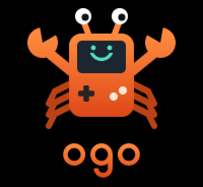

<p align="center"></p>

# ogo

An app launcher for the [ODROID-GO](https://wiki.odroid.com/odroid_go/odroid_go) handheld, written in
Rust. It installs native Rust apps, such as games, from the SD card into a flash slot and boots them.
Apps and launcher updates are managed from a web page served by the device itself.

## Features

- App library on the SD card, with icons, in sections for games and tools
- Installs an app into a dedicated flash slot and boots it; reinstalls are skipped when the app is
  unchanged
- Apps built on a small SDK (`ogo-sdk`): frame loop, input, sound effects and music, saves, pause
  menu, exit back to the launcher
- Recovery app, entered by holding MENU at power-on: start either launcher slot, or reinstall the
  launcher from the SD card
- Web page over WiFi, protected by a PIN shown on the device: upload and delete apps and the files
  they use (e.g. Game Boy ROMs), pick the WiFi network, see battery and free space
- Launcher updates from the web page, into the other of two launcher slots; if the new launcher
  doesn't start properly, the device goes back to the previous one by itself
- Settings screen (MENU): device info, brightness, volume and music on/off (all also used by
  apps), forget the WiFi network
- Sound in three modes, switched with VOL in apps: all sound, effects only (music off), muted

## What you need

- An ODROID-GO (ESP32 with 16 MB flash and 4 MB PSRAM, 320×240 display, microSD slot) and a USB
  cable. It connects through a Silicon Labs CP210x USB-to-UART bridge; Windows may need its
  [driver](https://www.silabs.com/developer-tools/usb-to-uart-bridge-vcp-drivers).
- A microSD card for the apps.
- [espflash](https://github.com/esp-rs/espflash/releases) to write the firmware: download the
  `espflash` binary for your system from its releases page (or `cargo install espflash` if you have
  Rust).

## Installing

1. **Back up the stock firmware** (optional, but it's the only way back):
   ```
   espflash read-flash 0 0x1000000 original-flash-16MB.bin
   ```
2. **Download** `ogo-<version>-full.bin` from the
   [latest release](https://github.com/FantasyTeddy/ogo/releases/latest).
3. **Flash it** with the device connected and switched on:
   ```
   espflash write-bin 0x0 ogo-<version>-full.bin
   ```
   espflash finds the port, or asks if there are several. This installs the bootloader, recovery and
   the launcher, and erases settings and saved WiFi networks.
4. **Switch the device off and on.** The launcher starts and shows the apps on the SD card.

## Apps

Each release also contains the apps as `.ogo` packages. To install one:

- **Over WiFi:** upload the `.ogo` file on the device's web page (see below).
- **On the SD card:** an `.ogo` file is a tar archive. Unpack it into a folder named after the app
  under `/ogo/apps/`, e.g. with the card as `E:\`:
  ```
  mkdir E:\ogo\apps\snake
  tar -xf snake.ogo -C E:\ogo\apps\snake
  ```

In the app list, **A** starts the selected app; the first start (or after an update) installs it
with a progress bar. **START** rescans the card, **SELECT** opens the WiFi screen, **MENU** the
settings, and **VOL** mutes or unmutes. In an app, **MENU** opens the pause menu with the volume,
music on/off and "Exit to launcher"; **VOL** switches between all sound, effects only (music off) and
muted. All of these are kept for the launcher and other apps too. Any reset while an app runs also
lands back in the launcher.

**GB** plays Game Boy games (the original, not Color) from your own ROM files: upload the `.gb` files
on the web page (under GB, "ROMs"), or copy them into `/roms/gb/` on the SD card, where other
emulators for the device look too. It shows them in a
list; **A** starts one, in the middle of the screen. The buttons are the Game Boy's; **MENU** opens the pause menu as in
every app, and **VOL** switches the sound on and off (Game Boy games play music and sound effects on
the same channels, so there's no switching off only the music). The pause menu also has
**Colours** (grey, the original's green, or the later pocket model's olive) and **Size** (1:1, or
1.5x with the in-between pixels blended). Games with a battery-backed save keep it in
`/ogo/saves/gb/`, saved when the pause menu opens and a few seconds after the game changed it.

**Adventure** is for children who can't read yet: walk around in a little tile world, meet animals
and people, find things. Everything answers with pictures and sounds, there's no text and no
fighting. Worlds are `.adv` files: upload them on the web page (under Adventure, "Worlds"), or copy
them into `/adventure/` on the SD card; a sample village is always there too. The start screen shows
each world's picture with its name small below it (**Left**/**Right**, **A**), starting at the one
played last; some worlds then let you choose who to be. The arrows walk, **A** looks at or talks to
what's in front, **B** runs. Each world remembers where you were and what you found, in
`/ogo/saves/adventure/`.

Worlds are made on the PC with the **Adventure editor** (in [adventure/editor](adventure/editor),
started with `cargo run --manifest-path adventure/Cargo.toml --target host-tuple -p
adventure-editor`). A world is a folder: `world.json`, the tileset `tiles.png` (16×16 tiles side by
side, drawn in any paint program) and the characters in `sprites/`. **New world from the sample
village…** and **New empty world…** (in the menu on "Adventure") ask for a name and create a folder
of that name. The world's settings, under Pictures, add tiles from a PNG (they go after the
existing ones in `tiles.png`, so the maps stay as they are), add pictures (copied into `sprites/`:
one 16×16 picture, or a row per direction and a column per step), and choose who the player is; a
picture facing the viewer turns by mirroring and hops a little when it walks. Under Sounds & music,
each sound and piece of music can be listened to; **Add sounds…** copies WAV files into `sounds/`
(a voice, an animal, a door), which become mono, 16 kHz and 8-bit with the quiet ends cut off, at
most 4 seconds each. **Import MIDI…** copies a MIDI file into `music/` as a song for the maps. A song
plays one part of the file as its melody and, if you like, another as its bass, each one note at a
time (where notes sound together, the melody keeps the top one and the bass the bottom one); the
editor suggests them, drums left out, and under "Parts" they and their sound can be changed and
listened to any time. The sample village's songs are MIDI files there too, so they can be changed
in any music program.
The maps are tabs above the map. A map has three layers, Ground, Decoration and Above (drawn over
the player, like treetops), and each tile knows its own: painting puts it there. A new tile goes on
Ground when its picture fills the cell and on Decoration when something shows through; a project
from before tiles had layers guesses them from where its maps use them. In the layer bar under the
map the layers being painted on are lit: the selected tile's (or a block's), or the one clicked,
which painting and erasing then keep to until another tile is chosen. The eye in each layer makes
it faint (a closed eye), turns it off (crossed out) and shows it again. A faint layer is
see-through, so the others stand out; one turned off isn't drawn (without the ground, a checkerboard
shows what's empty) and erasing and picking up pass it by. The palette shows the tiles of faint and
hidden layers darker. Otherwise erasing and picking up take the top tile shown, and an eraser stroke
stays on the layer it began on; painting on a layer that's off turns it on again. The
palette shows the tiles as they lie in `tiles.png` (drag its edge to make it wider); dragging across
it picks a block, like a whole house or a patch of grass, which the tools then paint whole, each tile
on its layer. Paint with pencil, fill, box and eraser, above the map; right-click picks up a tile.
The right panel shows the tile selected in the palette (its layer, solid, animated, a sound when
stepped on): a kind of tile, so changes apply wherever it's used. Where it lies on other layers
than its own, **Move them** puts it on its own. Solid tiles block on Ground and Decoration; above
the player nothing does. A map's settings (name, size, music) open from its tab (double-click,
right-click or "⋯"), the world's (title, tileset, characters) from its name. The **Objects** tab
places characters, items and invisible spots (e.g. in front of a door), with its own tools: Select
(click, drag to move), Place (click an empty cell), Remove, and Start (where the player starts).
The map steps back so the objects stand out. The right panel then shows that one object: its
picture, whether the player bumps into it or walks onto it, whether it stays, wanders or walks a
path, whether it's always there, and its rules: for bumping into it and for stepping onto it, each
"if … then" with actions like playing a sound, showing a picture, giving or taking items, setting
flags, making objects disappear, following the player, or taking the player somewhere (pick the
cell on the map). Items (with their pictures) and flags are named in the world's settings, which
also show how many rules use each. **Play** tries the world on a handheld in a window of its own, with its sounds and music made as the device makes them (its buttons light up,
and can be clicked), from the start or from the cell clicked last; **Export…** writes the `.adv` file, and **Send…** looks for the device at the
address on its WiFi screen and uploads the world to the Adventure app. The pictures reload by
themselves when their files change.

**Bluetooth** lists the Bluetooth LE devices nearby: phones, headphones, watches, trackers. Each row
shows the name, or for the many devices that send none, what they are where a published format says
so (e.g. "iBeacon", "Windows laptop", "Fast Pair", or "Google service" for a phone using Google's
services), else the address; then the maker and the signal strength. A dot marks devices that accept
connections. The list keeps its order, new devices at the end; **SELECT** sorts it by signal once.
Devices not heard for 15 seconds are dimmed, and after a minute they're gone.

**A** shows a device in detail: its address and whether it changes, maker, whether it accepts
connections, packets per second, its services, what its messages say, and its signal over the last
minute; there **A** beeps faster the stronger the signal, to find the device. For a device that
accepts connections, **START** connects and reads what it says about itself through the standard
services: name, kind (e.g. "Watch: Smartwatch"), maker, model, hardware, firmware and software
version, battery level, and all services it offers; values that need pairing say so, as the app never
pairs. The app only decodes formats that are published (by the Bluetooth SIG, Microsoft, Google, or
Apple's iBeacon), nothing reverse-engineered.

## Web page

Press **SELECT** in the app list. The device shows what to do, step by step:

- The first time (no WiFi configured), join the device's own WiFi `ogo-XXXX` (no password), open
  `http://192.168.71.1/` and enter the PIN shown. On the **Settings** tab, pick your WiFi; the device
  then joins it and shows its new address.
- Afterwards it joins your WiFi directly; open the address it shows from any device on that network.

Instead of picking the WiFi on the page, you can put it on the SD card as `/ogo/settings.toml`:

```toml
[wifi]
ssid = "MyNetwork"
password = "secret"
```

WiFi is only on while this screen is open; **B** switches it off again.

### Updating the launcher

Download `launcher.bin` from a [release](https://github.com/FantasyTeddy/ogo/releases) and upload
it on the **Settings** tab under "Update launcher". The device writes it into the launcher slot that
isn't running and restarts. The new launcher confirms itself once it's up; if it crashes before
that, the device returns to the previous one and says so. Settings → Device shows both slots with
version and commit.

## Recovery

Hold **MENU** while switching on, for about a second. The recovery app can start either launcher slot,
or install `/ogo/updates/launcher.bin` from the SD card into launcher slot A: copy a release's
`launcher.bin` there to use it. If MENU wasn't held (for example right after flashing), recovery
starts the launcher by itself.

Holding **SELECT** at power-on opens the launcher's hardware test screen.

## Restoring the original firmware

With the backup from step 1 of [Installing](#installing):

```
espflash write-bin 0x0 original-flash-16MB.bin
```

## Building from source, writing apps

See [CONTRIBUTING.md](CONTRIBUTING.md) for building, flashing and releasing, and
[docs/APPS.md](docs/APPS.md) for writing an app. How it works inside:
[docs/ARCHITECTURE.md](docs/ARCHITECTURE.md), [docs/CONTRACTS.md](docs/CONTRACTS.md) and
[docs/HARDWARE.md](docs/HARDWARE.md).

## License

[MIT](LICENSE).

ODROID and ODROID-GO are trademarks of Hardkernel. ogo is an independent project, not affiliated with
Hardkernel.
