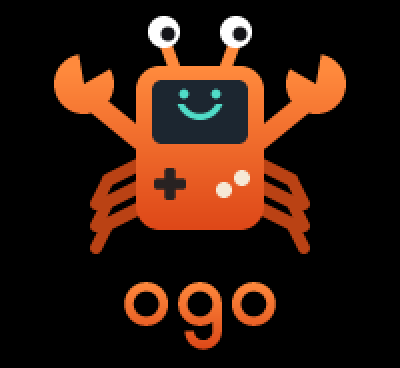

<p align="center"></p>

# ogo

An app launcher for the [ODROID-GO](https://wiki.odroid.com/odroid_go/odroid_go) handheld, written in
Rust. It installs native Rust apps, such as games, from the SD card into a flash slot and boots them.
Apps and launcher updates are managed from a web page served by the device itself.

## Features

- App library on the SD card, with icons, in sections for games and tools
- Installs an app into a dedicated flash slot and boots it; reinstalls are skipped when the app is
  unchanged
- Apps built on a small SDK (`ogo-sdk`): frame loop, input, sound effects and music, saves, pause
  menu, exit back to the launcher
- Recovery app, entered by holding MENU at power-on: start either launcher slot, or reinstall the
  launcher from the SD card
- Web page over WiFi, protected by a PIN shown on the device: upload and delete apps and the files
  they use (e.g. Game Boy ROMs), pick the WiFi network, see battery and free space
- Launcher updates from the web page, into the other of two launcher slots; if the new launcher
  doesn't start properly, the device goes back to the previous one by itself
- Settings screen (MENU): device info, brightness, volume and music on/off (all also used by
  apps), forget the WiFi network
- Sound in three modes, switched with VOL in apps: all sound, effects only (music off), muted

## What you need

- An ODROID-GO (ESP32 with 16 MB flash and 4 MB PSRAM, 320×240 display, microSD slot) and a USB
  cable. It connects through a Silicon Labs CP210x USB-to-UART bridge; Windows may need its
  [driver](https://www.silabs.com/developer-tools/usb-to-uart-bridge-vcp-drivers).
- A microSD card for the apps.
- [espflash](https://github.com/esp-rs/espflash/releases) to write the firmware: download the
  `espflash` binary for your system from its releases page (or `cargo install espflash` if you have
  Rust).

## Installing

1. **Back up the stock firmware** (optional, but it's the only way back):
   ```
   espflash read-flash 0 0x1000000 original-flash-16MB.bin
   ```
2. **Download** `ogo-<version>-full.bin` from the
   [latest release](https://github.com/FantasyTeddy/ogo/releases/latest).
3. **Flash it** with the device connected and switched on:
   ```
   espflash write-bin 0x0 ogo-<version>-full.bin
   ```
   espflash finds the port, or asks if there are several. This installs the bootloader, recovery and
   the launcher, and erases settings and saved WiFi networks.
4. **Switch the device off and on.** The launcher starts and shows the apps on the SD card.

## Apps

Each release also contains the apps as `.ogo` packages. To install one:

- **Over WiFi:** upload the `.ogo` file on the device's web page (see below).
- **On the SD card:** an `.ogo` file is a tar archive. Unpack it into a folder named after the app
  under `/ogo/apps/`, e.g. with the card as `E:\`:
  ```
  mkdir E:\ogo\apps\snake
  tar -xf snake.ogo -C E:\ogo\apps\snake
  ```

In the app list, **A** starts the selected app; the first start (or after an update) installs it
with a progress bar. **START** rescans the card, **SELECT** opens the WiFi screen, **MENU** the
settings, and **VOL** mutes or unmutes. In an app, **MENU** opens the pause menu with the volume,
music on/off and "Exit to launcher"; **VOL** switches between all sound, effects only (music off) and
muted. All of these are kept for the launcher and other apps too. Any reset while an app runs also
lands back in the launcher.

**GB** plays Game Boy games (the original, not Color) from your own ROM files: upload the `.gb` files
on the web page (under GB, "ROMs"), or copy them into `/roms/gb/` on the SD card, where other
emulators for the device look too. It shows them in a
list; **A** starts one, in the middle of the screen. The buttons are the Game Boy's; **MENU** opens the pause menu as in
every app, and **VOL** switches the sound on and off (Game Boy games play music and sound effects on
the same channels, so there's no switching off only the music). The pause menu also has
**Colours** (grey, the original's green, or the later pocket model's olive) and **Size** (1:1, or
1.5x with the in-between pixels blended). Games with a battery-backed save keep it in
`/ogo/saves/gb/`, saved when the pause menu opens and a few seconds after the game changed it.

## Web page

Press **SELECT** in the app list. The device shows what to do, step by step:

- The first time (no WiFi configured), join the device's own WiFi `ogo-XXXX` (no password), open
  `http://192.168.71.1/` and enter the PIN shown. On the **Settings** tab, pick your WiFi; the device
  then joins it and shows its new address.
- Afterwards it joins your WiFi directly; open the address it shows from any device on that network.

Instead of picking the WiFi on the page, you can put it on the SD card as `/ogo/settings.toml`:

```toml
[wifi]
ssid = "MyNetwork"
password = "secret"
```

WiFi is only on while this screen is open; **B** switches it off again.

### Updating the launcher

Download `launcher.bin` from a [release](https://github.com/FantasyTeddy/ogo/releases) and upload
it on the **Settings** tab under "Update launcher". The device writes it into the launcher slot that
isn't running and restarts. The new launcher confirms itself once it's up; if it crashes before
that, the device returns to the previous one and says so. Settings → Device shows both slots with
version and commit.

## Recovery

Hold **MENU** while switching on, for about a second. The recovery app can start either launcher slot,
or install `/ogo/updates/launcher.bin` from the SD card into launcher slot A: copy a release's
`launcher.bin` there to use it. If MENU wasn't held (for example right after flashing), recovery
starts the launcher by itself.

Holding **SELECT** at power-on opens the launcher's hardware test screen.

## Restoring the original firmware

With the backup from step 1 of [Installing](#installing):

```
espflash write-bin 0x0 original-flash-16MB.bin
```

## Building from source, writing apps

See [CONTRIBUTING.md](CONTRIBUTING.md) for building, flashing and releasing, and
[docs/APPS.md](docs/APPS.md) for writing an app. How it works inside:
[docs/ARCHITECTURE.md](docs/ARCHITECTURE.md), [docs/CONTRACTS.md](docs/CONTRACTS.md) and
[docs/HARDWARE.md](docs/HARDWARE.md).

## License

[MIT](LICENSE).

ODROID and ODROID-GO are trademarks of Hardkernel. ogo is an independent project, not affiliated with
Hardkernel.
